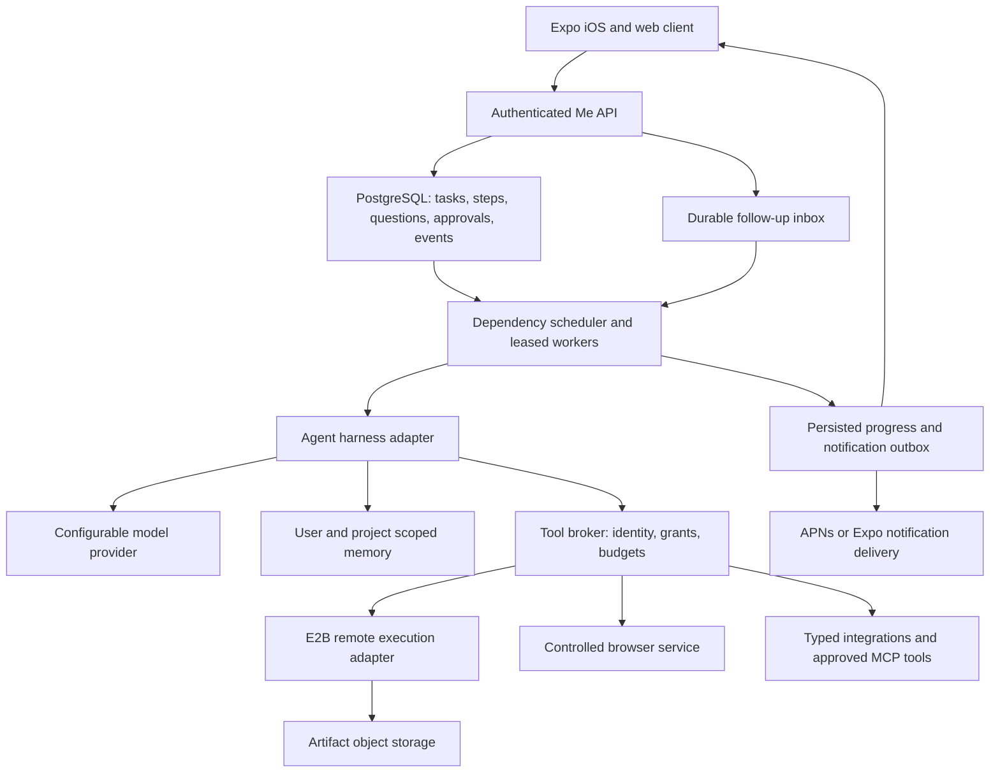

# Me: independent cloud personal-agent plan

Superseded by [product architecture](product-architecture.md). This draft interpreted independent execution as cloud-hosted execution. The user clarified that the agent and `infra-server` run on a separate computer in the user's home, while `backend-server` is hosted by Me. Cloud sandboxes and cloud agent hosting in this draft are not the product's default architecture.

Status: proposed plan, superseding the home-local plan for the current phase. Research and source inspection: 2026-11-02. No cloud resources have been provisioned and no upstream runtime has been executed in this workspace.

## 1. Confirmed direction

Build a general-purpose personal agent for our own team first, with a path to multiple independent users. Each user directs an agent through iOS/web; the agent uses our remote infrastructure and its own computer. It must continue after the client closes, preserve work, ask questions while independent work progresses, and return usable deliverables.

Core workflows: research, public-web browsing, document/file work, writing and debugging code, and creating animations. Connected-account actions follow after the execution and approval boundaries are proven. Persistent memory and explicit scheduled work make this a personal agent across sessions.

The existing Me website describes private inference and storage at home. This cloud phase changes that deployment and data boundary. Before exposing the prototype to users, clearly label where chat, memory, files, browser state, and model requests go. Do not carry the website's home-local claims into the cloud product. A later home-hosted executor can implement the same contracts; it is not a prerequisite for this prototype.

## 2. Recommended starting point

**Prototype from a pinned OpenMuse revision, retain its TypeScript/Expo stack and existing SQL-backed worker, and build Me's durable task graph and execution policy around it.** Treat OpenMuse as a reusable application starter, rather than assuming it is already a complete multi-user autonomous platform.

Source inspected: [CopilotKit/openmuse at a4944f4c471d3dc93b8bfc060b5da309b5216ab2](https://github.com/CopilotKit/openmuse/tree/a4944f4c471d3dc93b8bfc060b5da309b5216ab2). The repository is MIT-licensed. Its interface, browser service, task views, artifact flows, and review machinery offer a concrete reuse path. This is a source-based assessment; product quality still needs a live experiment.

Do not start by combining OpenMuse, FastAPI, Deep Agents, OpenAI Agents SDK, LangGraph, and Temporal. They overlap in runtime and task responsibilities. First prove the existing path. Keep a harness adapter boundary so a later agent-engine replacement does not rewrite the task API or client.

The proprietary products named in the discussion establish desired behavior, not verified information about their internal architectures. This plan does not depend on claims about their launch dates or implementation stacks.

### What source inspection actually establishes

| Area | Observed upstream implementation | Consequence for Me |
| --- | --- | --- |
| Client and API | Expo/React Native/web with Hono, CopilotKit, and AG-UI; built-in model path uses TanStack AI | Reuse TypeScript initially; a Python API rewrite has no demonstrated benefit |
| Persistent work | SQL task leases, checkpoints, progress, approval waits, and multiple eligible tasks in the worker | Extend this engine first; explicitly test subtask dependency semantics |
| Follow-up queue | Chat follow-ups are retained by the open app; delegated tasks run server-side | Move task-related questions/answers and follow-ups to a durable server inbox |
| Identity | Shared-key login resolves the current workspace to a single owner | Replace with real account identity before multiple people share a deployment |
| Computer | Optional E2B Desktop provider exists alongside Docker execution | We can prototype remote execution without building a desktop host from scratch |
| Threads | CopilotKit Intelligence is required in all current modes | Decide whether to accept that service or replace thread persistence; self-hosting this repo does not remove that dependency |
| Verification | Upstream records fixture and browser/container tests, with live-model and account tests remaining separate | Run our own acceptance suite; upstream recordings do not establish open-ended autonomous quality |

Evidence: [runtime](https://github.com/CopilotKit/openmuse/blob/a4944f4c471d3dc93b8bfc060b5da309b5216ab2/apps/server/src/agent.ts), [worker](https://github.com/CopilotKit/openmuse/blob/a4944f4c471d3dc93b8bfc060b5da309b5216ab2/apps/server/src/engine/worker.ts), [authentication](https://github.com/CopilotKit/openmuse/blob/a4944f4c471d3dc93b8bfc060b5da309b5216ab2/apps/server/src/auth.ts), [threads](https://github.com/CopilotKit/openmuse/blob/a4944f4c471d3dc93b8bfc060b5da309b5216ab2/docs/RICH-THREADS.md), and [verification boundaries](https://github.com/CopilotKit/openmuse/blob/a4944f4c471d3dc93b8bfc060b5da309b5216ab2/docs/VERIFICATION.md). The verification document predates some current source changes; its test counts are not a report of tests run on our selected revision.

## 3. Architecture and component choices



| Component | First implementation | Replacement condition |
| --- | --- | --- |
| Mobile/web | Reuse OpenMuse Expo/React Native components and AG-UI presentation | Replace specific screens when Me's workflows require it |
| API and agent | Reuse Hono/TypeScript and current built-in agent behind an adapter | Evaluate Deep Agents if measured planning/context/tool quality misses the acceptance suite |
| Durable orchestration | PostgreSQL-backed worker with transactional leases, persisted step dependencies, timers, and inbox | Consider Temporal when operational evidence shows the custom workflow engine costs more than migration |
| Computer | E2B adapter with scoped lifecycle and hardened access settings | Substitute another provider through the same interface if reliability/cost/control fails |
| Browsing | Existing Playwright browser worker for controlled workflows | Evaluate browser-use if exploratory browsing quality justifies it |
| Data | PostgreSQL for authoritative application state; private S3-compatible storage for artifacts | Add vector retrieval only after lexical retrieval and explicit memory prove insufficient |
| Notifications | Persisted outbox plus push delivery | Push is a wake-up hint; clients always fetch authoritative state |
| Diagnostics | Structured events, latency/cost metrics, redacted logs | Optional external observability only after its data handling is chosen |

Use hosted model APIs in the prototype if configured by the team. No local-model constraint applies to this cloud phase. Pin model versions where possible and evaluate one strong tool-calling model before adding routing. Record model/provider data destinations and retention settings; do not imply confidentiality merely because an executor is isolated.

**Thread-service decision:** the lowest-effort experiment may use CopilotKit Intelligence with clearly disclosed test data. Before the team alpha, either accept its service terms, cost, retention, deletion, and hosting model or replace its thread storage/replay integration with Me-owned persistence. Replacing it is engineering work, not an environment flag. Disable optional telemetry and optional external search integrations by default until intentionally configured.

## 4. The key behavior: only dependent work waits

Represent a goal as a persisted directed acyclic graph of steps. Each step declares dependencies, required input references, output contract, capability, grants, budget, and completion check. Validate plans for cycles and invalid tool references. The LLM proposes the graph; deterministic code validates and schedules it.

Example:

```text
Goal: compare three products and design our agent
  A: research confirmed product              ready -> running -> done
  B: identify ambiguous product             waiting_input(question-1)
  C: compare open-source frameworks          ready -> running -> done
  D: draft reusable architecture             depends C -> ready -> done
  E: complete final comparison               depends A, B, D -> waiting
```

The agent posts question-1 once, records what it blocks, and continues A/C/D. When an answer arrives from any device, the server stores an idempotent answer event, validates who may answer, invalidates affected assumptions, and wakes B. Unrelated completed work remains intact.

Persist `Goal`, `TaskStep`, `Dependency`, `Question`, `Answer`, `Action`, `Approval`, `Artifact`, `Schedule`, and `Event`. Public step states: `ready`, `running`, `waiting_input`, `waiting_approval`, `blocked_dependency`, `succeeded`, `failed`, `cancelled`. Distinguish a temporarily blocked branch from a terminally failed goal.

Questions identify affected steps and whether an answer is mandatory. Timeouts never count as approval. Optional questions can use a disclosed default; mandatory ones remain pending. Parent cancellation prevents all future branch dispatch. Limit concurrency per user and serialize writes to the same browser session, repository, or workspace.

Follow-up messages are durable server records, not just client UI state. If a new instruction changes a running task, apply it at a safe checkpoint, increment the plan revision, and reevaluate affected grants. Show a partial result if all remaining branches need input. Do not keep spending model calls while every branch is waiting.

## 5. Remote computer lifecycle and boundaries

Define a provider-neutral interface for create/attach, execute, file read/write, screenshot, preview, pause/resume, terminate, and export artifacts. Only the trusted control plane holds provider keys. Sandbox metadata and IDs must be bound to tenant, user, project, and environment; never trust an arbitrary sandbox ID from a client or model.

Default: one sandbox per active task/project, with no cross-user reuse. Keep account browser profiles in a separate user-scoped service. Persist durable results in object storage; a sandbox is working state, not the only copy of a deliverable. Destroy temporary environments according to retention policy.

Acquire execution leases while a job runs, heartbeat long operations, and pause idle environments when no active work needs them. A task running with the phone closed must not depend on a visible desktop tab refreshing its timeout. Extend the upstream short command budget with cancellable job handles and polling for builds/renders; do not merely raise every API request timeout.

OpenMuse's [E2B adapter documentation](https://github.com/CopilotKit/openmuse/blob/a4944f4c471d3dc93b8bfc060b5da309b5216ab2/docs/COMPUTER.md) describes unrestricted outbound access, reachable listening ports, passwordless sudo inside the VM, and a desktop stream bearer URL. Its approval enforcement covers specific application connectors, while general desktop/network behavior partly relies on agent instructions. These are constraints of that integration, not universal limitations of E2B.

Use the provider's [network controls](https://docs.e2b.dev/network/internet-access), protected ingress, and our own authenticated preview proxy where supported and verified. Never expose a raw development server containing task files. A domain allowlist alone cannot prevent an upload to an allowed domain or a form submission to a logged-in website.

For the first alpha, keep arbitrary code/render environments offline after curated dependencies are installed. Use a separate controlled public-web research browser without personal login credentials. Execute email, calendar, upload, or publishing through typed, approval-enforced connectors. General logged-in autonomous GUI work is a later capability until its commitment boundary is demonstrable.

[E2B persistence](https://docs.e2b.dev/sandbox/persistence) supports resumable sandboxes, but OpenMuse's inspected adapter deliberately uses filesystem-only pause, ending processes. Test the selected adapter's behavior rather than assuming a resumed browser, render, or command is still running. After recovery, reconstruct execution from recorded checkpoints and exported artifacts.

## 6. Capability delivery

| Capability | Initial end-to-end implementation | Completion evidence |
| --- | --- | --- |
| Research | Search/browse public sources, extract evidence, compare, write a report | Source URLs, retrieval times, report file, and a claims check |
| Code/debug | Import explicit repository snapshot, inspect, edit, run tests, bounded repair, produce patch and preview | Source/diff, actual test output, authenticated preview where applicable |
| Animation | Brief -> storyboard -> Manim source -> draft render -> frame review -> repair -> final output | Editable source, playable MP4, render output, duration/resolution and content checks |
| Documents | Read permitted attachments, extract structured information, create an output | Artifact and source references; review before external transfer |
| Personal memory | Explicit preferences, project decisions, authorized retrieval, correction/deletion | User can inspect the memory and identify its source/scope |
| Scheduled work | Explicit schedule creates ordinary budgeted tasks | Schedule history, disable action, deduplicated outcomes |

Start animation with Manim and templates; add Motion Canvas/other renderers through the same worker. Treat Remotion as a separately evaluated adapter because commercial use has specific terms. Generative image/video models add separate provider and resource choices; they are not necessary for useful programmatic animation.

General-purpose capability comes from composing a small set of reliable tools. One primary agent is enough initially. Add specialists only when evaluations show an advantage; all delegation inherits narrower grants, scoped context, resource limits, and cancellation.

## 7. Identity, permissions, memory, and recovery

Create real tenant/user/project identities before shared team access. Default projects and memories to private; shared projects require explicit membership. Enforce identity at task reads/writes, retrieval, browser/profile access, artifact downloads, notifications, thread replay, and sandbox attachment. A shared access key and a per-user sandbox are not sufficient account isolation.

Keep connector credentials in a secret broker. Give tool workers only task-scoped grants and data. Model keys, cloud control-plane keys, database credentials, and unrelated account tokens never enter a general execution environment. Never use one logged-in browser profile for all team members.

The tool broker deterministically allows, denies, or creates a review request. Approval binds actor, task/step, action type, canonical arguments, recipients/destination, payload/artifact hashes, policy revision, expiry, and one-time execution state. Approval of a plan does not grant arbitrary later mutations. Tool results and webpage content cannot authorize new actions.

Persist action intent before dispatch. Use connector idempotency keys where available; otherwise reconcile uncertain outcomes instead of automatically retrying. Crash recovery and duplicate notification taps must not cause duplicate sends, purchases, or publications. Cancellation halts future work, terminates applicable jobs, and reports external operations already dispatched.

Memory is separate from task checkpoints. Store explicit preferences, user/project scope, source, timestamps, retention, and provenance. Authorize before retrieval and include scope in cache keys. Provide edit/forget/export flows; propagate deletion through derived summaries, indexes, thread services, and backups according to disclosed retention. Add embeddings only after retrieval tests show a need.

Use client event cursors and a transactional notification outbox. Reconnect fetches current state plus missing events. Push notifications contain minimal information and open an authenticated task; losing or duplicating a push must not lose or repeat work. The database is the authority for tasks, questions, approvals, and results.

## 8. Repository responsibilities

| Repository | Cloud-phase responsibility |
| --- | --- |
| `agentic-framework` | Harness interface, step graph/scheduler, capability definitions, broker, memory access, execution adapters, evaluations |
| `backend-server` | Account/project access, external API, durable inbox, approvals, artifact authorization, event delivery and notification outbox |
| `infra-server` | Cloud deployment, PostgreSQL/object storage, worker operations, sandbox lifecycle, ingress/egress, secrets, monitoring, backup/restore |
| `phone-app` | Adapt reused Expo screens: goals/chat, branch progress, questions, approvals, previews, notifications, settings |
| `web-app` | Existing public site; add a clearly labeled cloud-prototype entry only when the product description and authenticated experience are ready |

Avoid immediately scattering an imported OpenMuse monorepo across all these repositories. First use an isolated checkout to validate the complete upstream path. Then extract reusable runtime/domain modules and client components with preserved license notices and recorded upstream revision. Define one canonical schema for tasks/events/approvals; do not duplicate it across backends.

API operations: submit goal, read task/steps, submit follow-up, answer question, resolve approval, cancel task, stream/replay events, fetch artifact, edit memory, and manage schedules. Mutations use idempotency keys; responses include tenant-scoped IDs and schema versions. Internal model traces and raw reasoning are not user-facing progress.

## 9. Phased implementation and decision gates

Estimate: three engineers covering runtime, platform/tools, and client/backend; approximately 8–12 weeks to a constrained internal multi-user alpha if upstream reuse works. These are planning estimates, not measured delivery commitments. Authentication, dependency-service replacement, and execution constraints may extend the schedule.

| Phase | Estimate | Deliverables and exit gate |
| --- | --- | --- |
| 0: live feasibility | 3–5 working days | Pin upstream, run with synthetic data, real model, PostgreSQL, and remote computer; close client and verify task continuation. Inventory actual external data paths and cost. Decide thread-service policy and whether to keep the harness. |
| 1: independent task | Weeks 2–3 | Me-owned task/event contract, durable follow-up inbox, dependency graph, separate leased worker, artifact export, reconnect flow. One question blocks one branch while another finishes. |
| 2: team boundary | Weeks 4–5 | Accounts, project membership, tenant-scoped storage, sandbox mapping, budget enforcement, broker/approvals, authenticated previews. Two users cannot access each other's tasks/files/profiles. No shared deployment is opened to a team before this gate. |
| 3: useful capabilities | Weeks 6–8 | Research reports, coding/test/repair workflow, animation render/revise/export, push notifications, explicit schedules, editable memory. Verify real outputs with the app offline. |
| 4: reliable alpha | Weeks 9–12 if needed | Restart/reconciliation drills, dependency outages, retention/delete/export, restore, cost controls, held-out task tests, onboarding and operational runbook. |

Use web first to shorten the runtime feedback loop, then exercise a signed iOS development build on a real device before claiming iOS background-task acceptance. JavaScript exports and simulator recordings do not establish push delivery or signed native installation.

### First tickets

1. **CF-001 — Feasibility checkout:** pin upstream and record live task/model/E2B/thread-service results. Deliver a keep/adapt/replace decision; no migration by assumption.
2. **CF-002 — Canonical task contracts:** define task, step dependency, question/answer, grant/approval, event, artifact, and sandbox ownership records.
3. **CF-003 — Durable non-blocking scheduler:** persist ready/waiting branches, transactional claims, answer wake-up, branch cancellation, plan revisions, and resource limits.
4. **CF-004 — Cloud execution adapter:** authenticated sandbox mapping, offline code worker, job lifecycle, artifact export, pause/resume, protected previews, and cleanup.
5. **CF-005 — Team authentication:** real sessions, membership, scoped retrieval/storage/thread access, artifact ownership, and revocation.
6. **CF-006 — Enforced external actions:** broker, stored review, credential scoping, action ledger, idempotency/reconciliation, and execution-time policy checks.
7. **CF-007 — Remote-control client:** goal submission, branch progress, durable questions/answers, approvals, artifacts, reconnect/replay, and cancel.
8. **CF-008 — Capability packs:** research, coding/debugging, and animation with task-specific result checks.
9. **CF-009 — Personal continuity:** authorized memory, explicit schedules, durable notifications, native push, and user-configurable budgets.
10. **CF-010 — Alpha operations:** measured quality suite, failure injection, restore/update rollback, deletion/retention, diagnostics, and spend monitoring.

CF-002 follows the feasibility decision. Scheduler and execution work can then proceed alongside client and identity implementation. Team access depends on CF-005; connected-account commitments depend on CF-006. Broader capabilities depend on working artifacts and task recovery, rather than just new prompts.

## 10. Acceptance suite and costs

The first acceptance scenario is: submit a research goal, terminate the app, let the remote worker finish, reopen to the persisted report, and receive a notification where permissions allow. The stronger scenario is: one branch asks a question, another creates an artifact, the worker restarts, and an answer from a second client resumes only the blocked branch.

Before internal alpha, maintain at least 40 versioned normal tasks plus independent failure/permission fixtures. Proposed targets: at least 80% independently checked completion on supported tasks, with per-capability results and intervention counts reported. Broader general-purpose claims require broader evaluation.

Mandatory scenarios: duplicated answer/approval events; expired grant; changed action arguments; cross-user object IDs; browser session/profile leakage; public preview access; raw network bypass; prompt injection; sandbox expiry; model timeout; worker lease expiry; stop during a render; disconnect/reconnect; failed push; and crash after a service accepts an external action.

Persist task state before acknowledgment; no accepted goal may disappear after restart. Measure p50/p95 time to first progress, completion time, queue delay, retries, and recovery time on the declared deployment. Test both live-model tasks and deterministic fixtures, labeling each. Record what was actually run, rather than copying upstream test counts.

Track variable cost per verified completed task:

```text
model input/output + sandbox active time + browser time
+ artifact storage/egress + search/API fees + retry overhead
+ allocated API/worker/database/thread-service cost
```

Also measure failed-task cost and idle infrastructure spend. Set per-task token/time/compute caps, per-user concurrency, daily/monthly spend limits, render quotas, and idle cleanup. An always-available agent should wait cheaply when idle or awaiting input; it need not run model inference continuously.

Do not choose hardware commitments or subscription pricing before measuring actual provider usage. Provider prices and limits must be checked again when provisioning; no price estimate is assumed here.

## 11. When to add another framework

Keep the built-in harness if it passes research, code-repair, animation, context, and permission tests. If it fails because of agent-loop limitations, compare it with Deep Agents using the same tasks/tools/model and integrate the winner behind the harness interface. Do not rewrite a working task engine just to change a model loop.

Keep the SQL worker if leases, timers, input/approval waits, dependency graphs, cancellation, and reconciliation remain understandable and tested. Add Temporal if long-running workflow evolution, operational recovery, or distributed coordination becomes a measured burden. A migration must assign one owner for durable scheduling; do not run two competing state machines for the same action. [Temporal activities](https://docs.temporal.io/activities) still require idempotency and explicit side-effect handling.

OpenBot is a desktop-oriented reference, rather than the main starting point for this remote-first phase. Its current [README](https://github.com/nightly-labs/openbot) documents broad execution privileges, so its execution policy should not be inherited as Me's approval model. OpenClaw/Hermes remain alternative complete assistants if OpenMuse integration costs exceed the reuse benefit.

The immediate next deliverable is a reproducible feasibility result and architecture decision, followed by one complete remote task path. Infrastructure creation, live account connections, public publishing, and paid provider use are implementation steps, not actions performed by this planning document.
