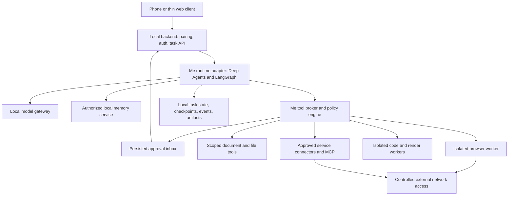

# Me personal agent: architecture and delivery plan

Historical draft. The canonical deployment and repository boundaries are now in [product architecture](product-architecture.md): the phone uses our hosted backend to reach an agent hosted on a separate computer in the user's home. This draft incorrectly places the application backend on the home computer and must be reconciled with that architecture before implementation. Its capability and evaluation sections remain reference material.

Status: proposed implementation plan; no runtime has been implemented or benchmarked.
Research date: 2026-11-02. Framework claims below come from linked upstream documentation; recommendations, estimates, and acceptance targets are Me design proposals.

## 1. Product and starting point

Build a persistent personal agent on Me Home that can understand requests, use tools, produce useful artifacts, remember authorized context, and continue work after the phone disconnects. The same agent should handle household assistance, research, browser tasks, coding/debugging, and animation creation through capability modules.

The inspected `agentic-framework`, `backend-server`, `infra-server`, and `phone-app` repositories contain bootstrap documentation and hygiene checks, rather than application implementations. `web-app` contains the public website, a scripted animated showcase, and a waitlist API. Its phone mockups are not an existing agent client.

The product contract established by the website is local private inference and storage, household-controlled access, and permission before contacting external services. The first real agent must preserve that contract.

First release scope: a developer/household alpha on a single Me Home, with a thin client and a documented hardware configuration. A reliable consumer appliance, broad desktop automation, and unrestricted autonomous purchasing require subsequent releases.

The references “OpenAI dot,” “Muse,” and “grokbot” are unresolved project names pending exact URLs. They are not treated as verified candidates or silently mapped to other projects.

## 2. Recommended reuse strategy

**Provisional choice: embed Deep Agents as the agent harness, use its LangGraph runtime, and build Me's household control layer around it.** Install pinned upstream packages and extend documented interfaces. Avoid maintaining a fork unless an evaluation reveals a concrete blocker.

[Deep Agents](https://github.com/langchain-ai/deepagents) provides planning-oriented execution, filesystem backends, context management, skills, subagents, and human review support. It is MIT-licensed and supports tool-calling models, including local models. These are upstream features, not evidence of Me task quality. [LangGraph persistence](https://docs.langchain.com/oss/python/langgraph/persistence) and [interrupts](https://docs.langchain.com/oss/python/langgraph/interrupts) provide the primitives for persisted execution and approval pauses.

Me should own identity, household rules, memory authorization, tool execution permissions, task records, artifacts, and the phone-facing contract. These remain stable if the harness changes. The framework's default filesystem, shell, delegation, and memory tools must be replaced or constrained through Me-controlled adapters; wrapping only newly added tools is insufficient.

Use one general agent initially. Select capabilities and skills according to the task. Add isolated specialist workers when a workflow needs a separate environment or when evaluation demonstrates a benefit. Default to serial execution on a home device; explicitly budget parallel workers.

### Alternatives and their intended roles

| Foundation | What upstream supplies | Proposed role and decision condition |
| --- | --- | --- |
| [Deep Agents + LangGraph](https://github.com/langchain-ai/deepagents) | Embeddable harness and persisted runtime | Preferred product foundation, subject to the evaluation below. Me supplies household controls and execution isolation. |
| [Hermes Agent](https://github.com/NousResearch/hermes-agent) | Personal assistant with memory, skills, scheduling, terminal backends, and configurable model endpoints; MIT | Best full-assistant challenger for the alpha. Choose it if its integration surface preserves all Me controls with substantially less engineering. Review automatic skill updates and every optional external memory/service integration. |
| [OpenClaw](https://github.com/openclaw/openclaw) | Self-hosted assistant gateway, channels, tools, and swappable model integrations; MIT | Strong full-product challenger, especially if messaging channels become central. Evaluate an isolated per-user deployment rather than assuming its shared gateway meets Me's family privacy requirements. |
| [nanobot](https://github.com/HKUDS/nanobot) | Smaller Python personal-agent implementation with memory, scheduling, local endpoints, and MCP; MIT | Lightweight baseline and fallback if device resources or integration complexity rule out larger candidates. Test recovery and authorization rather than inferring them from feature lists. |
| [LangGraph directly](https://github.com/langchain-ai/langgraph) | Lower-level orchestration runtime; MIT | Fallback if the opinionated harness creates persistent policy or context-management problems. Requires building more of the agent loop. |
| [OpenHands Software Agent SDK](https://github.com/OpenHands/software-agent-sdk) | Embeddable coding agents, tools, workspace execution, and server APIs; MIT | Optional coding worker, not a second household orchestrator. Add only if the initial coding capability misses its quality target. |

OpenClaw documents [one trusted boundary per gateway](https://docs.openclaw.ai/gateway/security). It also documents host execution for the main session unless sandboxing is configured. This is an integration constraint, not a claim that OpenClaw is unsuitable for every household deployment.

No framework supplies all of Me's product guarantees automatically. “Runs locally” describes deployment; it does not establish that model calls, tracing, plugins, or tools remain local.

### One-week selection experiment

1. Freeze a 30-task fixture set before tuning: six each for personal memory/documents, browsing, coding/debugging, animation/artifacts, and recovery/permissions. Add separate adversarial permission tests.
2. Pin releases/commit identifiers, dependency locks, model revision, quantization, prompts, tool set, and device configuration. Record licenses and optional service dependencies. Research currently describes upstream main branches; the experiment must select actual releases.
3. Compare Deep Agents, Hermes, and OpenClaw on identical tasks and local model endpoints. Use nanobot as a small-footprint baseline only if capacity permits; do not delay the decision for exhaustive framework coverage.
4. Spend equal, capped integration time on each. Record unsupported adapters as integration cost rather than silently giving candidates unequal tools.
5. Eliminate candidates that cannot enforce the tool broker, isolate user data, run without unapproved external calls, or pause/recover safely. Score remaining candidates: task correctness 35%, local latency/resource use 20%, integration effort 20%, recovery 15%, dependency/maintenance burden 10%.
6. Report task-level outcomes and repeat the leading candidates three times. A small fixture set supports an engineering choice, not a universal performance claim.
7. Write an architecture decision record with measured results, upstream versions, known failures, and the chosen foundation. If no local model passes, narrow the supported alpha workflows and rerun; do not silently enable cloud inference.

## 3. User-visible workflows

| Workflow | End-to-end behavior | Evidence of completion |
| --- | --- | --- |
| Personal assistance | Answer from the user's allowed files and memories; ask before adding ambiguous or sensitive durable memories | Answer cites the local source; saved memory is inspectable, correctable, and deletable |
| Research | Obtain scoped external access, browse allowed sources, synthesize findings, and save a report | Source links, retrieval timestamps, and report artifact |
| Browser task | Navigate an isolated user browser, inspect state, fill a draft, and pause before an external commitment | Page evidence plus approval and resulting confirmation, or an explicit blocked result |
| Code/debug | Create a task workspace, inspect code, edit, execute tests, use failure output, and repair within a bounded loop | Patch/source, test results, and runnable local preview where applicable |
| Animation | Convert a brief to scenes and code, render a preview, inspect frames, revise, and export | Editable source, playable output, render logs, and checks of duration/resolution/content |
| Recurring task | User explicitly creates a schedule with an allowed capability and scope; scheduler starts a normal persisted run | Inspectable schedule, execution history, cancel control, and approval pause where needed |

Example acceptance story: “Create a 20-second animation explaining fractions for Maya.” The agent uses the authorized child profile, creates a storyboard and Manim source, renders locally, checks frames and duration, and returns an MP4 plus editable source. A subsequent “make the labels bigger” reuses that task's artifacts. Sharing it with a teacher is a separate external action with recipient and attachment approval.

General purpose means new workflows can compose the same capabilities and produce verifiable outputs. It does not mean every installed application or website works at launch.

## 4. Runtime architecture



Deploy the backend, runtime, databases, inference, and worker infrastructure on Me Home. The `backend-server` name does not imply a cloud service. Runtime endpoints bind to loopback/internal networking; only the authenticated application API is exposed to paired clients over the local network.

Use Python for the first runtime and worker integration because the shortlisted harness and browser/coding SDKs provide Python interfaces. Keep language-neutral JSON/OpenAPI contracts for clients. Use TypeScript inside animation workers where needed. This is a proposed stack, not an existing repository constraint.

Use local PostgreSQL for application records and production checkpoints, plus an access-controlled local artifact directory. Use framework-compatible persistence adapters rather than inventing checkpoint serialization. Start with database full-text retrieval; add local embeddings/vector indexing only if retrieval evaluation justifies it. No hosted database, trace service, or vector store is required.

### Task lifecycle and recovery

Public states: `queued`, `running`, `awaiting_approval`, `awaiting_input`, `succeeded`, `failed`, `cancelling`, `cancelled`. Track worker leases and recovery internally. A durable task ID is distinct from its conversation ID and framework checkpoint/thread ID.

Persist the request and trusted identity, resolve allowed context, select tools, run a bounded think/tool/observe loop, check the result, and save artifacts plus a user-visible completion summary. Every step has a time, tool-call, output-size, and resource budget.

After a process restart, recover expired worker leases and resume from persisted state. Reconstruct browser sessions where possible and revalidate page state before continuing. If an external action's outcome is unknown, enter reconciliation or ask the user; never blindly replay it.

Framework checkpointing does not imply exactly-once external actions. Use stable action IDs, database transactions/outbox records, connector idempotency keys when supported, and confirmation reconciliation for other services. Nodes that resume after an interrupt may execute again; keep side effects outside replayable planning code.

Stopping a task revokes future execution grants and terminates its workers. Already completed external actions may require a separate compensating action; the interface must report what happened.

## 5. Capabilities and execution environments

### Browser

Use [browser-use](https://github.com/browser-use/browser-use) as the initial browser-agent candidate; it supports a local browser and local model configuration. Start with deterministic browser automation for known flows and use the agent for exploratory navigation. Confirm the selected release exposes interception points for every navigation and action; otherwise restrict it to an isolated read-only workflow or substitute a lower-level browser adapter.

Give each user a dedicated browser profile and each task an isolated context where feasible. Scope account reuse explicitly; never share a parent's cookies with a child or import a system browser profile automatically. Provide interactive handoff for login, CAPTCHA, and MFA.

The worker must enforce outbound destination rules, redirects, downloads, uploads, and access to local/private addresses. Test DNS rebinding and WebSocket/other browser egress, not only top-level URL strings. A home-network device requires an explicit separate connector grant.

Prefer typed service APIs for sending, booking, or buying because their action payloads are easier to inspect and constrain. Browser commitments remain preview-and-confirm in the alpha. Site redesigns, anti-bot controls, and uncertain page state produce a handoff rather than invented success.

### Code and debugging

Start with the chosen harness's brokered file/search/execute tools in a dedicated workspace. Implement the loop: inspect → edit → run a relevant test/command → read output → repair → verify. Bound iterations; return the actual failure when the budget expires.

Workers receive only task files and explicitly imported source repositories. Mount inputs read-only where possible, keep generated outputs separate, run as an unprivileged user, cap CPU/memory/processes/storage, and deny network by default. Package installation uses a separately authorized dependency-fetch step or curated cached images.

For household pilots, put untrusted execution behind a VM boundary; on a Linux appliance evaluate [gVisor](https://gvisor.dev/docs/) for compatible workers. Rootless containers can support the developer spike but are not the complete isolation argument. Never expose the host Docker socket, home directory, credential database, or unrestricted host terminal to the agent. Measure compatibility and overhead on the chosen hardware.

Return diffs and test evidence. Publishing, pushing, opening a public endpoint, or deploying a created app requires its own grant. Add an [OpenHands SDK](https://github.com/OpenHands/software-agent-sdk) worker only if it improves measured coding outcomes enough to justify another runtime; its internal terminal and file tools must obey the same environment and network boundaries.

### Animation and creative work

Start with [Manim Community](https://github.com/ManimCommunity/manim), an MIT-licensed engine for programmatic explanatory animations. Add [Motion Canvas](https://github.com/motion-canvas/motion-canvas) for TypeScript-based informative motion graphics after the first renderer works. Both are rendering tools, not independent personal-agent frameworks.

Use templates first: titles, diagrams, labels, transitions, charts, and simple scenes. Pipeline: brief → storyboard/scene specification → generated source → low-resolution render → inspect sampled frames and logs → bounded repair → final render → source/output artifact bundle. Reuse the coding worker's isolation rather than adding unrestricted render commands.

Automated duration/codec/frame checks cannot establish that an animation teaches the right concept. Add rubric-based content and visual review; use a validated local vision model or human review for the alpha. Do not claim visual verification if no frame was actually inspected.

Remotion can be a later adapter if its React authoring fits the product, but its [commercial-use terms](https://www.remotion.dev/docs/license) require a separate product decision. The current website's animated demo does not establish a reusable rendering backend. Generative image/video models are later optional capability packs with their own hardware and model-license requirements.

### Integrations and skills

Provide typed first-party tools for memory, files, tasks, browser actions, execution, and artifacts. Add [MCP](https://modelcontextprotocol.io/docs/learn/architecture) as an adapter for extensibility. Protocol compatibility is not permission enforcement: validate schemas, pin trusted servers, restrict their process/network access, and broker credentials.

Each capability manifest declares its ID/version, input/output schemas, permissions, network destinations, filesystem roots, execution backend, resource budget, and completion checks. Skills provide instructions/examples/templates and reference those tools; they cannot grant themselves permissions.

User-installed/community skills and automatically suggested improvements enter a reviewable, versioned state. Do not allow an agent to promote new executable code, dependencies, or broader grants simply because an earlier task succeeded. Run regression fixtures before enabling a changed skill.

## 6. Personalization, privacy, and household policy

### Memory design

Separate conversation history/checkpoints, durable user preferences, user-approved household facts, retrieved documents, and artifacts. Every item carries household/user ownership, visibility, source, timestamps, retention, and deletion metadata.

Perform authorization before retrieval and before constructing a model prompt. Include identity and visibility in cache keys and retrieval filters. A model prompt saying “do not reveal other users' data” is not an access-control system.

Default private chats to the requesting user. Household sharing is explicit. Guardian control of a child's tools does not automatically imply access to every private conversation; define and disclose that product policy before a family pilot. Pairing and user switching must bind the active user to device credentials, not a user ID supplied in a prompt.

Persist a preference from an explicit user instruction; ask about inferred or sensitive long-term memories. Show a memory viewer with correction, forget, export, and retention controls. Deletion must cover retrieval indexes, derived summaries, caches, and the relevant persisted conversation state; document backup expiry and what an exported artifact cannot retract.

### Permission enforcement

The deterministic broker returns `allow`, `request_approval`, or `deny` for each action based on authenticated user, capability, exact operation, data scope, destination, and current household policy. The model may propose an action but cannot authorize it.

| Action | Initial behavior |
| --- | --- |
| Read explicitly attached local files | Allow inside that task's scope |
| Edit/run code in the isolated task workspace | Allow if the task granted that capability and budget |
| Retrieve a different user's private memory | Deny |
| Access external sites | Require a scoped external-access grant; show destinations and data involved |
| Send, submit, upload, book, buy, or publish | Show exact commitment and request action approval |
| Broad filesystem access, raw secrets, or host administration | Deny in the alpha |
| Child request outside guardian policy | Deny or route to a guardian approval as the policy specifies |

A user request such as “research these three sites” can provide scoped authorization when the interface clearly discloses external access. Avoid asking before every page read inside an existing grant. New destinations, private-data disclosures, accounts, and commitments require reevaluation.

Approval records bind approver, task, action ID, canonical argument digest, destination, data/attachment references, policy version, expiration, and one-use status. The broker atomically claims the grant, rechecks current policy, and refuses changed arguments. Cross-device duplicate taps must not dispatch duplicate actions. Editing a proposed action creates a new approval. Delegated workers inherit a subset of the parent's grants.

Browsers share IP addresses, request URLs, cookies, and potentially page-loaded third-party requests. The product must disclose that reality. “Only shopping-list items leave the house” is supportable only for a constrained connector with an inspected payload and a defined metadata disclosure, not arbitrary website browsing. Treat external content as untrusted data; never let a webpage, document, or tool result create a new grant.

Store service credentials in a separate local secret broker, inject them only into authorized connectors, and redact logs. Keep application encryption keys separate from encrypted backups; define owner recovery and device-reset behavior. Use disk encryption and authenticated local transport. The local machine owner remains part of the trust boundary; row-level access control cannot protect against a malicious host administrator.

## 7. Models, hardware, and resource budgets

Use one validated tool-calling local model first. [llama.cpp](https://github.com/ggml-org/llama.cpp) is a candidate inference server with quantization, multiple hardware backends, and an OpenAI-compatible API; [Ollama](https://github.com/ollama/ollama) is an alternative packaging/inference option. Choose one operational path for the alpha.

Validate actual tool calling, argument schemas, stop behavior, streaming, cancellation, context truncation, image inputs where applicable, and structured output. An endpoint being OpenAI-compatible does not establish that the model follows the tools correctly. Review the selected weight license separately from the inference server license.

Select model revisions through the fixture suite on an existing development machine, then validate on candidate appliance hardware before committing to a bill of materials. Compare a smaller and a larger local candidate at equal task budgets. Record RAM/VRAM including KV cache, throughput, time to first useful event, end-to-end task latency, idle/load power, and thermal behavior.

Reserve interactive inference capacity while renders or code tasks run. Queue expensive work; expose progress and cancellation. Start with one heavy worker and increase concurrency only after measuring multi-user contention. Schedule model unload/load if necessary and report the latency penalty.

Alpha defaults: local inference, local embeddings if enabled, local traces, disabled external telemetry, no cloud model fallback. Verify with network observation. Optional cloud inference would be a later, explicitly labeled mode requiring a product/privacy change; approval of a website action does not authorize uploading the entire chat to a model provider.

## 8. Repository and API boundaries

| Repository | Responsibility |
| --- | --- |
| `agentic-framework` | Runtime adapter, capability contracts, broker/policy evaluation, checkpoints, memory access interfaces, workers, scheduler execution, artifacts, and agent evaluations |
| `backend-server` | Paired-device identity, authentication, household/profile administration, public task/approval/artifact APIs, authenticated event delivery; invokes runtime using trusted identity |
| `infra-server` | Local deployment, inference service operation, worker isolation, network policy, certificates/secrets provisioning, resource limits, updates/rollback, backup/restore |
| `phone-app` | Pairing, chat/tasks, progress, approval inbox, artifact preview, memory/rule controls, notifications, and cancellation |
| `web-app` | Existing public website/demo; optional separate authenticated development client, kept distinct from waitlist/signup |
| `feed-algorithm` | Feed ranking and optimization; consumes authorized goals through a contract, without getting blanket chat-history access |

The backend owns the client-facing API. The framework owns its internal typed commands/events and generates or publishes a versioned contract; do not expose framework checkpoint internals to phones. Backend auth establishes identity; runtime authorization independently enforces it. Policy administration and policy execution must share a versioned schema, not two separate rule implementations.

Proposed application endpoints: create/list/get tasks, stream task events, cancel a task, list/resolve approvals, retrieve task artifacts, manage explicit memories, and create/disable schedules. Use idempotency keys on mutation requests, authenticated artifact authorization, pagination, and event replay cursors.

Core records: `Task`, `Run`, `ToolAction`, `Approval`, `PolicyGrant`, `MemoryItem`, `Artifact`, `Schedule`, and versioned `TaskEvent`. Include actor, household, correlation IDs, schema versions, and timestamps. Persist event IDs so the client can reconnect without losing an approval or duplicating an outcome.

User-visible events include task started, plan/progress summary, tool activity, approval requested/resolved, artifact ready, and task completed/failed/cancelled. Do not expose raw internal reasoning or unredacted tool logs as progress. Keep sensitive task metadata out of notification payloads.

Suggested framework layout:

```text
src/me_agent/
  contracts/       runtime/         models/
  policy/          approvals/       memory/
  tools/           capabilities/    workers/
  artifacts/       persistence/     scheduler/
skills/            evals/           tests/
docs/decisions/    examples/        pyproject.toml
```

This layout is a proposal; bootstrap files remain intact until implementation begins.

## 9. Delivery sequence and ownership

Planning assumption: three full-time engineers covering runtime/models, tools/isolation, and backend/client, with part-time product/design support. Target roughly 12 weeks to a constrained household alpha after kickoff; this is an estimate, not a consumer-launch commitment. Hardware, a new native client, or weak local-model results can extend it. A solo implementation should keep the same gates and substantially reduce scope.

| Phase | Estimated window | Main deliverables | Exit gate |
| --- | --- | --- | --- |
| 0: choose foundation | Week 1 | Fixed fixtures, three-candidate experiment, model/hardware baseline, decision record | A documented local-only candidate passes mandatory policy controls and representative tasks |
| 1: usable core | Weeks 2–3 | Runtime, local inference, persisted task/event API, thin client, pairing/auth, initial memory | An authenticated user submits a local task, reconnects, sees its result, and cannot access another user's task |
| 2: safe execution | Weeks 4–5 | Broker, persisted approvals, per-user scopes, isolated code worker, artifacts, cancellation | Draft → approve → execute survives restart and rejects altered/replayed actions |
| 3: capabilities | Weeks 6–8 | Browser research/draft workflows, code repair loop, Manim render loop, source/preview delivery | Research report, tested code patch, and checked animation all work through the client |
| 4: personal agent | Weeks 9–10 | Editable memory, explicit household sharing, guardian policy, recurring schedules, resource queue | Two users keep private state isolated; a scheduled task respects current grants and can be disabled |
| 5: household alpha | Weeks 11–12 | End-to-end regression suite, backup/restore, versioned deployment/rollback, onboarding, recovery drills | Release gates below pass on target hardware and a small consented pilot can operate without engineering intervention for normal tasks |

Build the native phone shell in parallel once the task/event/approval contract stabilizes. A development web client can validate the runtime earlier; it does not make native phone delivery free. Remote access and public message channels remain later scope.

### Initial implementation backlog

| ID | Work item | Owner | Depends on | Acceptance evidence |
| --- | --- | --- | --- | --- |
| AF-001 | Fixtures, candidate adapters, framework/model decision | Runtime | None | Reproducible report with versions, failures, resource measurements |
| AF-002 | Task/event/action contracts and backend API skeleton | Runtime + backend | AF-001 | Generated client contract and reconnectable task fixture |
| AF-003 | Paired-device authentication and user-scoped storage | Backend | AF-002 | Cross-user access tests, revocation, and reconnect flow |
| AF-004 | Local model gateway and cancellation/budget support | Runtime | AF-001 | Real structured tool call, streamed response, timeout/cancel cases |
| AF-005 | Persisted runtime/checkpoints and worker lease recovery | Runtime | AF-002, AF-004 | Kill/restart a run and complete without losing task identity |
| AF-006 | Broker, grants, approval records, secret interface | Tools + backend | AF-003, AF-005 | Changed arguments, expired grants, and unauthorized identities rejected |
| AF-007 | Isolated workspace executor and artifact store | Tools + infra | AF-006 | Host paths/secrets/egress unavailable; patch and test artifact returned |
| AF-008 | Thin task/approval/artifact client | Client | AF-002, AF-003 | Submit → progress → approve/decline → inspect result → cancel |
| AF-009 | Browser research and draft capability | Tools | AF-006, AF-007 | Local-browser fixtures, destination constraints, handoff and approval cases |
| AF-010 | Animation capability and render verification | Tools | AF-007, AF-008 | Render, revise, export, and reopen editable source |
| AF-011 | Durable memory and guardian policy integration | Runtime + backend | AF-003, AF-006 | Visibility, correction/deletion, and guardian decision fixtures |
| AF-012 | Explicit schedules, update/restore drills, alpha release | Runtime + infra | AF-009–AF-011 | Schedule revocation, no duplicate commitments after restart, restored home state |

First development slice after the selection: an authenticated user asks the local model to create a small file, receives a persisted artifact through the client, and can reconnect to the completed task. Add an approval-gated external action immediately afterward. This validates the integration backbone before broad capability work.

## 10. Evaluation and release gates

Expand from the 30-task selection set to at least 60 versioned normal tasks before alpha, with held-out variants to detect tuning to templates. Maintain an independent adversarial suite. Prefer local deterministic websites and code fixtures for repeatability; label live-web results separately.

Proposed alpha targets, to be confirmed after the first measurements:

- At least 80% independently verified completion on the explicitly supported task suite, with at least 70% in every capability category. Report retries, intervention, unsupported cases, and repeat-run variance separately.
- Zero observed unauthorized actions in tests for cross-user retrieval, approval mutation/replay, prompt-injection-driven scope expansion, secret access, and network/path escape. Passing tests is release evidence, not a guarantee that all attacks are solved.
- Local chat/document/code/render workflows continue with WAN disconnected after initial dependency/model provisioning. External workflows report their dependency clearly.
- No unapproved outbound data in observed network tests; inspect model, tool, telemetry, update, dependency-fetch, and browser paths separately.
- Kill/restart tests before/after approval, before/after dispatch, after a remote service accepts an action, and during artifact writes. Uncertain outcomes reconcile without blind replay.
- Cancellation prevents subsequent tool dispatch; targeted worker termination within a proposed five-second budget under normal conditions. Disclose operations already completed.
- Baseline local chat targets p95 time to first useful output under five seconds on the declared hardware/model at one interactive user. Record cold-start and loaded-device results separately; revise supported hardware or models if missed.
- Animation outputs meet declared duration/resolution and pass content/visual review; code changes pass task-relevant tests; research claims have inspectable sources. Agent self-report alone is not a completion judge.
- Backup/restore and rollback work on a clean device; logs and notifications redact secrets; clients can export/delete authorized data.

Operational metrics: completion by capability/model/version, approval frequency, refusal/block reasons, repairs per task, queue time, p50/p95 latency, peak RAM/VRAM/disk use, worker failures, and external destinations. Store diagnostics locally; sharing a diagnostic bundle is explicit and reviewable.

## 11. Deferred scope and decisions still needed

After alpha: authenticated remote access, additional connectors/channels, stronger coding workers if justified, voice, richer rendering tools, desktop/computer use, proactive suggestions, and feed integration. Each reuses the same grants, artifacts, identity, and task lifecycle.

Do not make the first milestone depend on a plugin marketplace, many simultaneous agents, model training, an autonomous self-modifying agent, or a universal computer-control layer. Purchases and similar real-world commitments remain preview-and-confirm until their connector-specific recovery is proven.

Decisions that can proceed with defaults: Python runtime, embedded harness, local PostgreSQL, local inference, a thin client, Manim first, serial heavy workers, and local-network access only. These are reversible proposals.

Decisions requiring evidence or product input: exact comparison-project URLs; target appliance hardware and budget; supported first-user workflows; whether guardian supervision includes any chat visibility; final model/weight license; existing team capacity; native-phone priority; and whether optional cloud inference should ever be offered. The evaluation, artifact pipeline, and core contracts can proceed before most of those choices are finalized.

The recommended next milestone is the one-week framework/model experiment followed by a recorded decision. Implementation should then build one working end-to-end task path and expand capability by capability, with measurable correctness and privacy boundaries at every gate.
