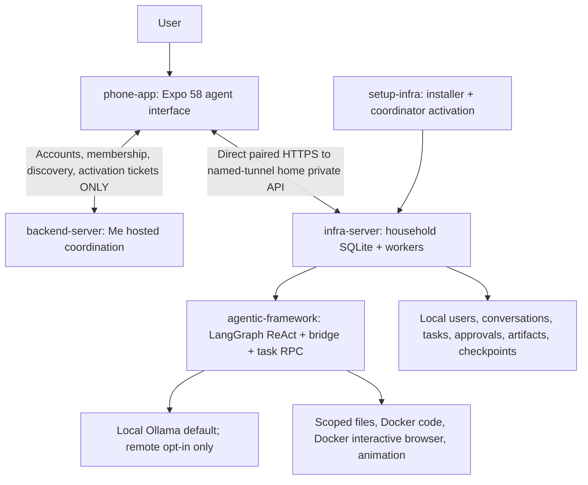

# Me product architecture

Status: implemented on `main` (foundation PR #1; upstream agent infrastructure PR #2, merged 2026-11-03). No deployed release. Canonical description of the home + hosted-backend + phone system as implemented. Supersedes all earlier hosted-relay / cloud-executor / single-user assumptions in prior personal-agent plans. Those older plans remain in-repo only as labelled superseded history; this file is authority for what was built.

Implementation source: sibling checkouts under `<me>` (`infra-server`, `agentic-framework`, `backend-server`, `phone-app`, `setup-infra`). No real GitHub CI / deploy / public tunnel / IdP / native push proof is claimed. Operator quickstart below links the per-repo guides rather than duplicating their command walls; portable paths use `<me>` and never hard-code a home absolute user path as a prerequisite.

## Canonical deployment (implemented)

- Phone: Expo 58 prototype imported from `Personal-AI-Showcase-3/artifacts/me-mobile` is the UI baseline. It talks to two distinct systems that must never be conflated:
  1. Me hosted `backend-server`: OIDC / accounts / membership / discovery / activation tickets ONLY. No private chat relay, no private payload storage, no second home scheduler, no hosted tunnel/edge.
  2. Home private API over a direct paired HTTPS named-tunnel URL: all conversations, tasks, artifacts, approvals, files.
- Home: separate household SQLite service (`infra-server`) + unchanged Open Muse worker + Python LangGraph SDK runtime (`agentic-framework`). Scoped files / browser-Docker / code-Docker / animation, durable questions + approvals + parallel children + restart recovery. Local Ollama default; remote models are explicit opt-in and prompts/tool context leave home only then.
- No private chat relay/storage at cloud. Notifications are opt-in home Expo with generic payloads only (installation/task/device/kind/event ids, fixed generic title/body); the backend never carries private content.
- One-time account activation ticket is redeemed only at the home (no OAuth JWT ever leaves the phone to the home). Private `HomeToken` (`me_home_…`, mode `0600` file, H8 heartbeat every ~60s) keeps coordinating automatically; a cloud outage never blocks the private phone↔home API.
- Private phone URL comes ONLY from the trusted LOCAL `home-pairing-v1` invitation (setup `bootstrap --format pairing-v1` stdout, delivered out-of-band). A cloud `endpointHint` is NEVER a trust anchor: no credential rebind on changed URL, no auto-rebind from backend discovery (F8 `PAIRING_REQUIRED`), fresh local invitation required for any endpoint move.
- Household private identities (home `user_id` / `device_id` / session `ht1_…`) are distinct from cloud membership (`acct_<sha256(iss,sub)>` + owner/member). The home verifies paired device + household authorization on every private route.
- "Model memory" means persisted conversation history + versioned run checkpoints scoped to owner/conversation/run. No invented semantic-RAG memory, cross-conversation retrieval, MCP integrations, or voice/calls in production (demo-only call simulation stays clearly labelled).

The hosted backend coordinates accounts/homes; private traffic goes direct phone→home. There is no cloud fallback executor when the home is offline.

## Repository responsibilities (implemented)

| Repository | Where it runs | Owns |
| --- | --- | --- |
| `phone-app` | User's phone | Conversations/tasks/approvals UI, home pairing (`home-pairing-v1`), backend coordination (discovery/join/presence), one-time activation-ticket mint (F9), opt-in Expo notifications (F8) |
| `backend-server` | Me hosted | OIDC JWT verification (`jose`, static issuer/audience/JWKS), account identity `acct_<sha256>`, registration/join/activation tickets (B7), home heartbeat/status with server-side `online`, membership revocation. JSON `backend-state.json`, single-process, no chat relay |
| `infra-server` | Home computer | Household SQLite + private `home-api-v1` (H1), task lifecycle/workers (H2/H6), coordinator heartbeat loop (H8), notifications outbox (H7), backup/restore, health |
| `agentic-framework` | Home host (subprocess) | LangGraph `create_react_agent` pinned `langgraph==1.2.19` / `prebuilt==1.1.1` (deprecated-upstream name kept as compatible 1.x checkpoint alias, strict serde, legacy 0.6 resume), `runtime-bridge-v1` + `task-rpc-v1`, 9 brokered tools + 4 delegation tools, R9 strict allowlist deserialization |
| `setup-infra` | Install/maintenance | Prereq checks, install/configure, tunnel-config adapter (named tunnel only, no provisioning), coordinator prepare/activate, bootstrap pairing invitations, service units, backup/restore, diagnostics |

`setup-infra` prepares/maintains; `infra-server` operates; `agentic-framework` executes inside it. Browser, code, and render work run isolated on the home host by default.

## End-to-end operator path (implemented, per-repo guides authoritative)

1. Install prerequisites: Node 24.18.x (`node --version`), Python 3 + maintained SDKs (`pip install -r requirements.txt` from `<me>/agentic-framework`; exact pins in that repo), sibling checkouts under `<me>`. No absolute home user path is a prerequisite.
2. Start loopback home once so the SQLite DB mints its authoritative `installation_id` (`infra-server` `start --db=...`, or setup `me_setup.py setup` + `me_lifecycle.py start`, or `bootstrap --user=` for the initial DB). The fresh-setup initial reserved config UUID is NOT usable — `coordinator.prepare` / `activate` require the REAL authoritative home SQLite ID. Do not publish any pre-start reserved-UUID activation flow.
3. Provision the named-tunnel hostname + least-privilege credential out-of-band (operator's own Cloudflare account, provider tooling; setup never provisions). Record locally: `tunnel configure --hostname … --credential-file …` (`setup-infra/docs/production-tunnel-boundary.md`).
4. `coordinator prepare --data-dir DIR [--public-url https://…]` — authoritative install + locally configured public URL. No network, no secrets. `endpointHint` comes from here, never from a ticket.
5. Owner phone mints one-time activation JSON (`DevicePanel → Home activation ticket`, `POST /v1/homes/activation-tickets`, F9). Copy `{backend_url, ticketId, activationSecret, installationId, mode, homeId?, expiresAt}` to the home operator (never an account JWT).
6. `coordinator activate --data-dir DIR < ticket.json` (ticket JSON via STDIN only, ticket-only `POST /v1/homes/activate`, no `Authorization` header, `redirect: 'error'` never followed — see `backend-server/docs/home-activation-v1.md` B7). Writes the exact 7-key `home-coordinator-v1` file (`protocol`, `backend_url`, `home_id`, `installation_id`, `home_token`, `endpoint_hint`, `protocol_version`) `0600` outside git. Account flow is optional for an already-paired private install.
7. Service reload REQUIRED (`stop` + `start`; activate never auto-restarts active jobs). `coordinator status` / `check` (redacted) + backend `GET /v1/homes/:id/status → online:true`.
8. Pair phones LOCALLY: `bootstrap --user … --format pairing-v1` → trusted `home-pairing-v1` JSON on stdout only → phone enrolls device → `ht1_…` session. Cloud hint never autofills this URL.
9. Use: conversations → tasks → clarifying questions / parallel children (`delegate_task` / `await_children`, R8) → approvals (`request_approval`, browser `browser_act` gated) → artifacts (sha256-verified, bounded) → opt-in push (generic payload, dedupe on `event_id`) → `backup --scope full` on the stopped service (DB + tasks + household files + private checkpoints; config/operator env/coordinator secrets excluded; workspace MAY contain private cookies/user keys so backups are never claimed secret-free; auth revoked on restore → fresh pair; durable WAL journal rollback, not one atomic transaction; A→B rebase pending resume test is explicit, not hidden).

Default synthetic smoke needs no valid real provider (fixture model + loopback URLs). Live-model checks are explicit opt-in with synthetic prompts only, never household data.

Details: `infra-server/docs/end-to-end-runbook.md` (home lifecycle), `setup-infra/docs/home-coordination-activation.md` (S7 sequence), `phone-app/docs/home-activation.md` (F9) + `phone-app/docs/client-adapter.md` (F1/F2/F3/F8), `backend-server/docs/home-activation-v1.md` + `backend-server/docs/backend-api-v1.md`, `infra-server/contracts/home-coordination-v1.md` + `infra-server/contracts/home-api-v1.md` + `home-notifications-v1.md`, `agentic-framework/docs/runtime-bridge-v1.md` + `runtime-browser.md` + `runtime-delegation.md`.

## Household data and isolation (implemented)

Home SQLite owns: household/users, conversations/messages, attachments, tasks/runs, approvals/inbox, memory records, artifacts metadata, browser sessions, push bindings/outbox, derived indexes, retention/backups. Framework `graph.db` checkpoints + `pending.json` are versioned run internals, never the read path for a person's history. Backend `backend-state.json` holds only coordination (tickets verifiers, membership, heartbeat) — never message content.

Access defaults enforced at home on every request: user-private conversations/memory/files/browser profiles/connected accounts; explicit shared household/project spaces with membership; guardian powers as explicit policy (admin ≠ implicit private-chat access); per-conversation history + task context; owner-scoped retrieval (10 messages / 2k chars each / 20k total, user+assistant roles only, no semantic RAG, resume-checkpoint only); per-user/task limits + fair queue (3-in-flight worker cap + home fanout/depth/root guards); serialized conflicting ops; versions/transactions for concurrent edits.

History survives app closure and home restart (SQLite WAL + task workspaces + checkpoint resume). Retention/export/deletion per user; deleting a conversation documents artifact/summary/memory effects; upgrades preserve data; reinstall never silently erases memory.

## Availability and trust boundaries (implemented)

| Condition | Behavior |
| --- | --- |
| Phone closed/offline | Home work continues; phone catches up on reconnect (dedupe on `request_key` / `event_id`) |
| Home powered off/asleep | Agent unavailable; backend/client show honest offline (`online:false` server-computed) |
| Home internet disconnected | Local work continues where deps allow; coordination/remote tools wait/retry |
| Hosted backend unavailable | Accepted home work continues; direct paired access unaffected; coordination/relay unavailable |
| Home restarts | Persisted tasks recover; uncertain external effects reconcile, never blind-replay; child leases fence stale pumps |

Trust: TLS + locally-trusted pair URL is the actual boundary. Server UUID correlation (`installation_id` match → `wrong_home` with zero network on mismatch) is correlation only, never server authentication. Credential-bearing fetches use `redirect: 'error'` and same-origin final-URL checks — redirects are failures, never followed, even to `https://`. No app-layer crypto or second server trust system is invented.

## Capability reality (implemented, not stubs)

- `run_code`: Docker one-shot only (`ME_RUNTIME_SANDBOX=docker`, `--network none`, read-only mounts, 64MB tmpfs `/work`); no host fallback under any flag; container files ephemeral — bounded stdout/stderr streams are the artifacts (`output/exec/stdout.txt`/`stderr.txt`).
- `browser_open`: real isolated interactive Playwright (`mcr.microsoft.com/playwright/python:v1.64.1-noble`, `--network none`) via vetted HTTP broker (allowlist + per-hop global-IP DNS pin + manual max-3 redirects + caps); readonly open/snapshot/scroll/screenshot need no approval; click/fill/press pause `awaiting_approval` (`browser_act`, fingerprint + `args_hash` binding). Missing Docker/image fails `prerequisite_missing`. Earlier real-host Chrome synthetic-DOM proof exists but production is Docker-image only (image build + local Docker still manual operator steps).
- `animation_build`: Pillow real GIF + editable `scene.py`/`scene.json` + relative `preview.html`; MP4 needs operator `ffmpeg` or the GIF stands honestly.
- Delegation (R8): `delegate_task`/`list_children`/`get_child`/`await_children` over fd-3 `task-rpc-v1`, home-enforced fanout 3/depth 1/root 4, durable `waiting_children` + `waiting_input`/`awaiting_approval` interrupts, CAS wake, cancel cascade, cross-user isolation.
- Models: `langchain-ollama` local default; `langchain-openai`/`langchain-anthropic` explicit `ME_RUNTIME_ALLOW_REMOTE=1` + key env only. Strict live Muse final (fixed response-block extract, parent ORBIT/English + 5-byte child artifact + one assistant message) passed 47.5s; no further live calls. No loopback-proxy bypass (loopback ignores ambient proxy).
- Native phone: Expo SDK 58 declared, F8/F9 supported app-SDK paths implemented; `expo-clipboard ~58.0.4` + `RN virtualized-lists` in the official type-mirror (51 packages incl. clipboard, zero ambient SDK stubs, full-project semantic `noEmit` exit 0 with Expo `skipLibCheck`), unit 86 + real 2 + syntax 52 per F9; native binary build itself remains a manual operator step. This semantic type graph is not claimed equivalent to a full native bundle.
- CI pin-update PR reuses the Open Muse worker ONLY, not upstream full features; `npm`/`pip`/`actions` dependabot + manual full-SHA system acceptance. Never a consumer-production 100% claim.

Superseded history: `cloud-personal-agent-plan.md` and `personal-agent-plan.md` predate this deployment and are retained only as labelled superseded proposals. The reuse audit (`reuse-audit.md`) records the selection evidence. Delivery sequencing lives in [product-delivery-plan.md](product-delivery-plan.md); test evidence + manual gates in `backend-server/docs/final-validation.md`.
